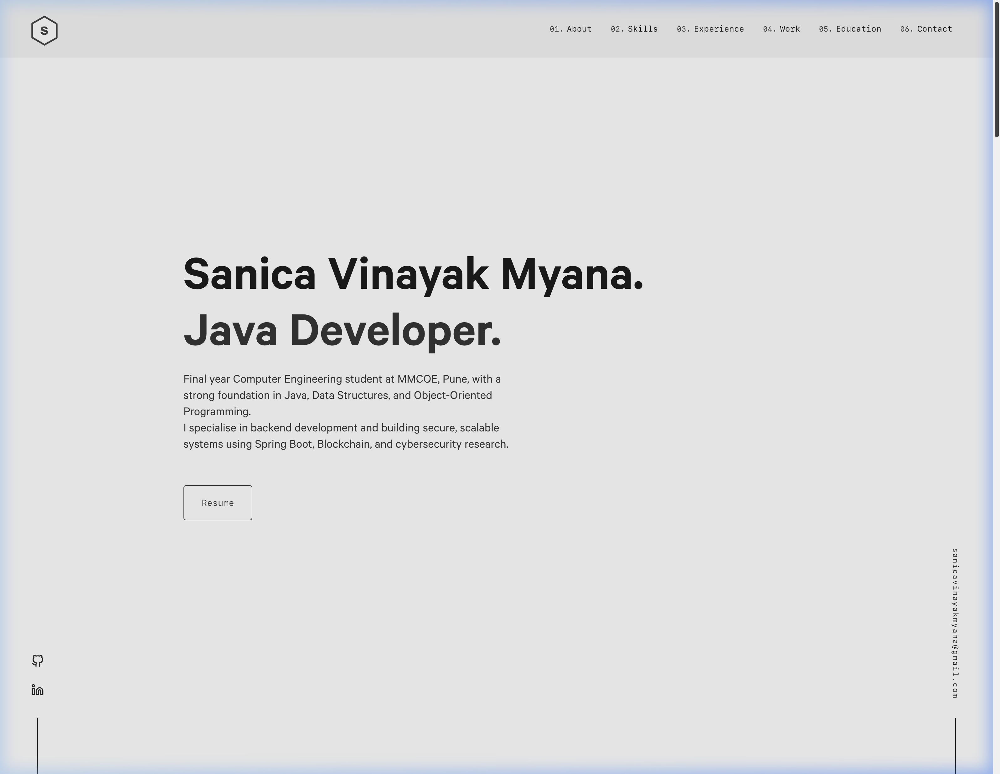

<div align="center">
  
</div>
<h1 align="center">
  Sanica Vinayak Myana - Portfolio
</h1>
<p align="center">
  A clean, beautiful, and responsive portfolio website built with <a href="https://www.gatsbyjs.org/" target="_blank">Gatsby</a>.
</p>

<p align="center">
  <a href="https://sanicavinayakmyana.com" target="_blank">
    
  </a>
</p>



## 👤 About Me

Final year Computer Engineering student at MMCOE, Pune, with a strong foundation in Java, Data Structures, and Object-Oriented Programming. I specialise in backend development and building secure, scalable systems using Spring Boot, Blockchain, and cybersecurity research.

## 🔗 Links

- **GitHub**: [github.com/SanicaVinayakMyana](https://github.com/SanicaVinayakMyana)
- **LinkedIn**: [linkedin.com/in/sanicavinayakmyana/](https://www.linkedin.com/in/sanicavinayakmyana/)
- **Email**: [sanicavinayakmyana@gmail.com](mailto:sanicavinayakmyana@gmail.com)

---

## 🛠 Installation & Set Up

1. Install the Gatsby CLI

   ```sh
   npm install -g gatsby-cli
   ```

2. Install and use the correct version of Node using [NVM](https://github.com/nvm-sh/nvm)

   ```sh
   nvm install
   ```

3. Install dependencies

   ```sh
   npm install --legacy-peer-deps
   ```

4. Start the development server

   ```sh
   npm start
   ```

## 🚀 Building and Running for Production

1. Generate a full static production build

   ```sh
   npm run build
   ```

1. Preview the site as it will appear once deployed

   ```sh
   npm run serve
   ```

## 🎨 Color Reference

| Color          | Hex                                                                |
| -------------- | ------------------------------------------------------------------ |
| Navy           |  `#0a192f` |
| Light Navy     |  `#112240` |
| Lightest Navy  |  `#233554` |
| Slate          |  `#8892b0` |
| Light Slate    |  `#a8b2d1` |
| Lightest Slate |  `#ccd6f6` |
| White          |  `#e6f1ff` |
| Green          |  `#64ffda` |

---

> [!NOTE]
> This portfolio is a fork of [Brittany Chiang's v4 portfolio template](https://github.com/bchiang7/v4).
